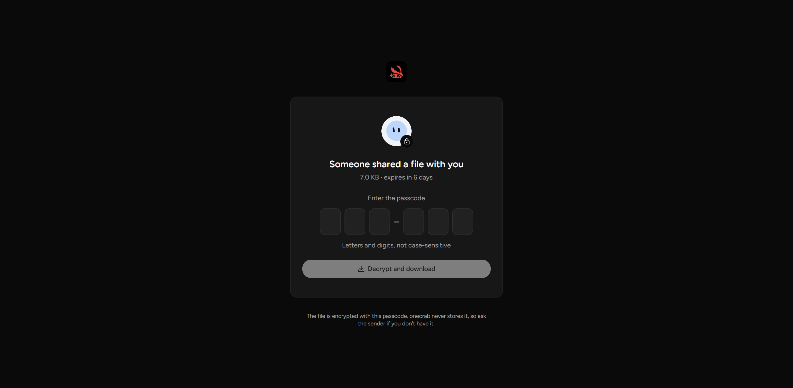

<h1>Onecrab<br/><br/></h1>

A small, invite-only file sharing app. Members upload files of up to 5 MB, which are encrypted with a passcode before they are stored.




## Development

```sh
yarn          # install dependencies
yarn dev      # start the dev server
yarn run check  # type-check (bare `yarn check` is yarn's builtin, not this script)
yarn test     # run the tests
```

## Configuration

| Variable   | Description                                                              | Default  |
| ---------- | ------------------------------------------------------------------------ | -------- |
| `ORIGIN`   | Public origin of the app, e.g. `https://files.example.com`. Required in production. | none     |
| `DATA_DIR` | Directory holding the database and stored files.                         | `./.onecrab` |
| `BODY_SIZE_LIMIT` | Max request body for adapter-node. Must stay above the 5 MB upload cap. | `6M` in Docker; set it yourself when running `node build` |
| `ADDRESS_HEADER` | Header carrying the client IP (e.g. `X-Forwarded-For`) when behind a reverse proxy; used by the Guess Limit. Without it every client looks like the proxy. | none |
| `XFF_DEPTH` | How many trusted proxies append to `X-Forwarded-For`; the client IP is read that far from the right. | `1` |

Copy `.env.example` to `.env` for local use.

## Docker

```sh
docker build -t onecrab .
docker run -d --name onecrab -p 3000:3000 \
    -v ./data:/app/data \
    -e ORIGIN=https://files.example.com \
    onecrab
```

The image runs as the non-root `node` user and keeps all state in `/app/data` (declared as a volume), so data survives container restarts. Make sure the mounted directory is writable by uid 1000. Backing up means copying that directory. onecrab runs as a single instance only.

## First-time setup

On first boot, the server prints a Setup Link of the form `/setup/<id>/<id>` to its logs. Open it in a browser to create the superadmin account:

```sh
docker logs onecrab
```

If the superadmin password is lost, reset it with:

```sh
yarn admin:reset
```

# LICENSE

MIT
